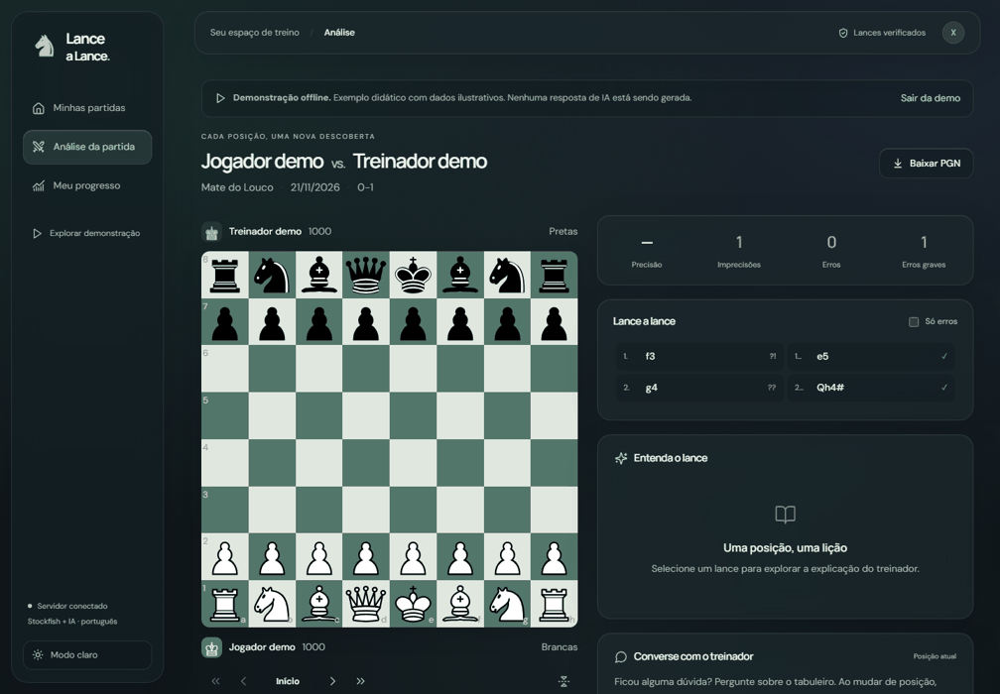
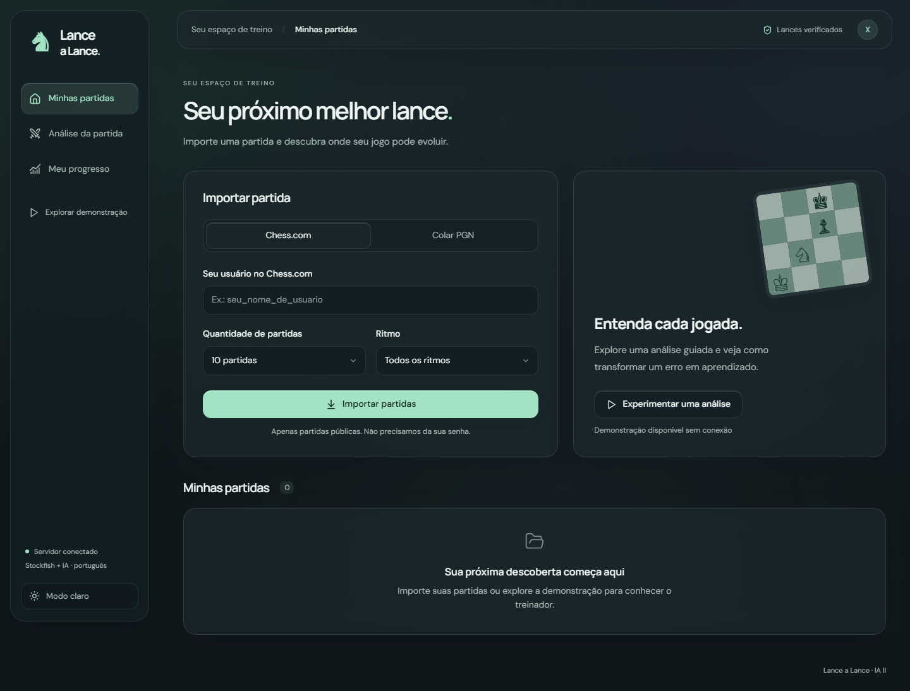
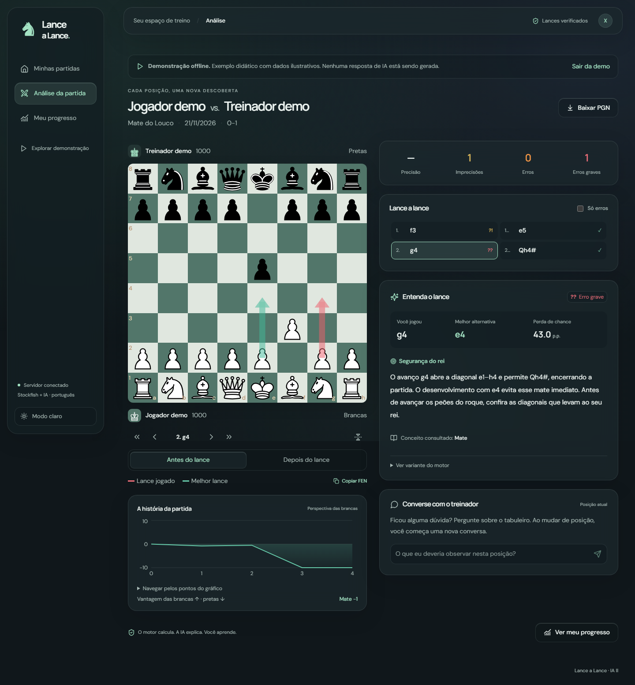
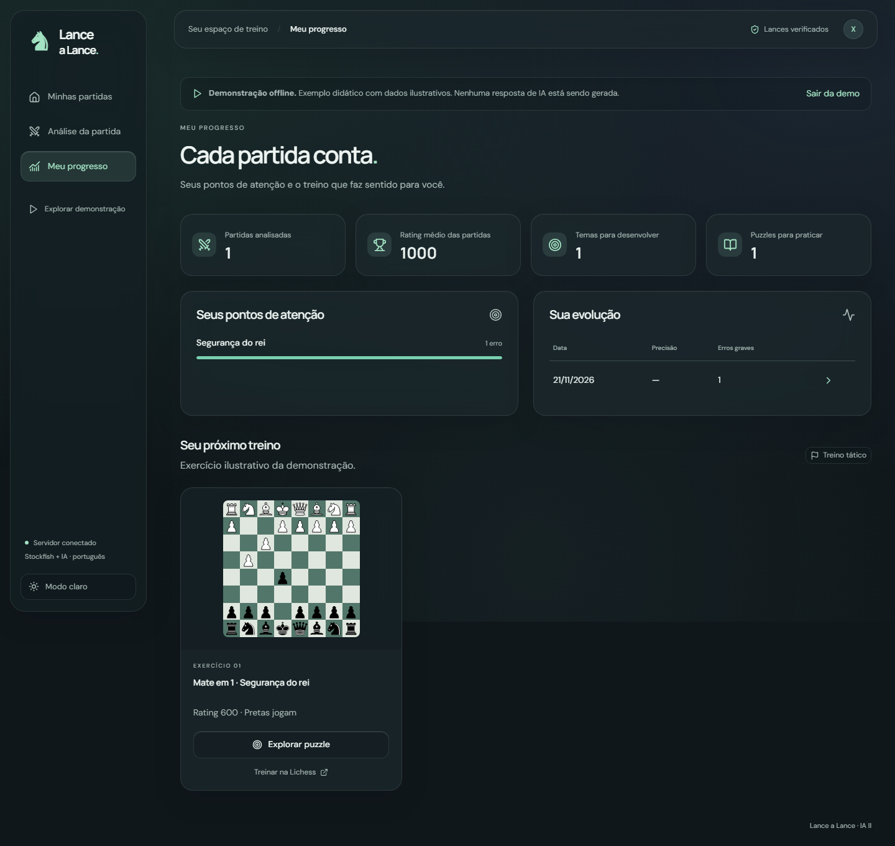

# Lance a Lance

Treinador de xadrez do Trabalho 2 de Inteligência Artificial II. O Stockfish
identifica alternativas, o classificador mede a perda de chance de vitória e o
agente explica os erros em português com fatos verificáveis e fichas táticas.



O GIF mostra a demonstração offline com dados ilustrativos. A interface também
consome a API real para importar, analisar, explicar lances, conversar sobre a
posição e consultar o relatório.

[Guia da interface](frontend/README.md) ·
[Guia de execução e demonstração](docs/EXECUCAO_COMPLETA.md) ·
[Verificação da integração real](docs/verificacao-integracao.md) ·
[Tarefas restantes do Milton](docs/pendencias-milton.md) ·
[Registro do teste SUS](docs/sus.html) ·
[Roteiro do pitch](docs/roteiro-pitch.md)

## Aplicativo no Windows

Com Python 3.11+ e Node.js 22+, na pasta `trabalho-2`:

```powershell
.\preparar.ps1
.\iniciar.ps1
```

Acesse `http://127.0.0.1:5173`. O preparo mínimo instala a API, baixa o Stockfish
oficial e prepara os puzzles. Para explicações com RAG e chat, use
`.\preparar.ps1 -ComRag` e configure o provedor/modelo autorizado no `.env`.
Configure também o contato real em `CHESSCOM_USER_AGENT` para importar pelo
Chess.com. O `.env` é local e não deve ser versionado.

### Telas





Há modos claro e escuro e layout para celular. O teste de usabilidade SUS com
cinco participantes ainda precisa ser aplicado. O formulário em `docs/sus.html`
registra as respostas e calcula as notas, sem resultados fictícios.

A integração em Linux foi verificada no navegador contra o Compose com Stockfish,
MCP, SQLite, ChromaDB e o Qwen3 1.7B já instalado no Ollama. Para abrir a
demonstração real, execute os serviços e importe o PGN público da Lichess
incluído no projeto. [PGN da demonstração](data/demos/xdFXCpYF.pgn) ·
[Verificação inicial no Windows](docs/verificacao-interface.md)

[Documentação acadêmica](docs/lance-a-lance-documentacao-do-projeto.pdf) ·
[Integração com o frontend e contratos HTTP](docs/integracao-frontend.md) ·
[Modo Jogar contra IA](docs/JOGAR_CONTRA_IA.md) ·
[Treinador em tempo real](docs/TREINADOR.md) ·
[Protocolo experimental](evaluation/README.md)

## Arquitetura

```text
React → FastAPI → cliente MCP → FastMCP
           │                        ├── Stockfish UCI e python-chess
           ├── SQLite               ├── API pública do Chess.com
           └── LangGraph            ├── SQLite de puzzles da Lichess
                └── MCP             └── ChromaDB e fichas em português
```

- `backend/` contém API, modelos Pydantic, fila e persistência de partidas,
  lances, explicações e tarefas.
- `mcp_server/` contém o servidor de ferramentas com transporte stdio e
  Streamable HTTP.
- `agent/` contém os grafos de explicação e chat, classificador, validador e
  prompts versionados.
- `knowledge_base/` contém 30 fichas Markdown e a indexação ChromaDB com
  Sentence Transformers. O modelo padrão é MiniLM multilíngue.
- `data/` contém a preparação e os índices de puzzles e o benchmark HTTP.
- `evaluation/` contém dataset, métricas, exportações e avaliação cega.
- `frontend/` contém o trabalho visual do Milton. A interface acessa apenas
  a API HTTP.

## Ferramentas MCP

| Ferramenta | Entrada principal | Saída |
| --- | --- | --- |
| `analisar_posicao` | FEN, profundidade 18 e MultiPV 3 por padrão | Avaliação na perspectiva de quem joga, candidatos e variante em SAN |
| `analisar_partida` | PGN, cor `white`, `black` ou `ambas`, intervalo opcional | Lances SAN/UCI, FENs, avaliações, classe e melhor alternativa |
| `jogar_stockfish` | FEN inicial, histórico UCI e dificuldade | Jogada legal do adversário, nome do motor e opções UCI aplicadas |
| `validar_lances` | FEN e lances SAN ou UCI | Legalidade e SAN normalizada |
| `descrever_posicao` | FEN | Material, peças, ataques, defesas, cravadas, xeques e situação dos reis |
| `buscar_partidas` | Usuário, máximo e ritmo opcional | Jogos públicos do Chess.com, ordenados por término, com PGN |
| `buscar_puzzles` | Temas, ratings mínimo e máximo e quantidade | Puzzles com FEN para resolver, solução UCI e link |
| `buscar_conceitos` | Pergunta, quantidade e tema opcional | Trechos com título, tema e fonte Markdown |

A análise de partida avalia os dois lados para que o tabuleiro navegue por
todos os meios-lances. Antes e depois são normalizados para quem fez o lance.
O classificador existente usa a curva logística e perdas de 10, 20 e 30
pontos percentuais como limiares. Mate é guardado explicitamente. O gráfico
usa a perspectiva fixa das brancas.

O backend processa blocos de até quatro meios-lances em segundo plano e
persiste o progresso no SQLite. A busca de partida usa profundidade 12 e
MultiPV 1 por padrão. SQLite reaproveita posições avaliadas e tarefas
concluídas do mesmo perfil. O fluxo interativo mantém profundidade 18 e
MultiPV 3. Ao abrir um erro, a interface pode pedir `POST /api/explicar`.
A explicação usa a análise gravada quando disponível. O LangGraph recupera
fatos e ficha, gera texto e confere versões SAN na variante antes de publicá-lo.
Um fallback determinístico também passa pelo validador. Explicações completas
validadas são persistidas. O chat mantém o vínculo com o FEN e o lance
selecionado e consulta as ferramentas do grafo para a pergunta atual.

O adaptador de LLM é compartilhado pela API e pelo executor experimental. Ele
usa Chat Completions no Ollama e aceita provedores OpenAI compatíveis. O
LangGraph conduz as ferramentas de explicação. No chat, o modelo também pode
solicitá-las e o validador verifica as jogadas antes da publicação. Quando o
perfil estruturado está habilitado, os fatos de tabuleiro entram como opções
verificadas e a lição em português é redigida pelo modelo.

## Executar com Docker

Na raiz de `trabalho-2`, com Docker e Compose v2.17+:

```bash
cp -n .env.example .env
docker compose up --build
```

A interface fica em `http://localhost:5173`. A API fica em `http://localhost:8000`, o Swagger em
`http://localhost:8000/docs` e o OpenAPI em `http://localhost:8000/openapi.json`.
Frontend, backend e MCP têm health checks. O navegador usa a própria origem
para `/api`, via proxy Nginx. A API aguarda o MCP também após
reinício. Entre contêineres, o MCP usa Streamable HTTP com respostas JSON
no endereço interno `http://mcp_server:8001/mcp`. A imagem instala
Stockfish 15.1 do Debian. Na primeira inicialização, o MCP baixa o modelo de
embeddings e indexa as 30 fichas. Os volumes `dados`, `chroma` e `modelos`
preservam SQLite, o índice e os pesos. `docker compose down` preserva os
volumes. Use um worker de API por banco para a recuperação das tarefas.

Configure `CHESSCOM_USER_AGENT` com o contato da equipe e habilite Ollama
local com `qwen3:1.7b` para geração e chat. O guia traz o perfil do modelo,
o acesso a partir da bridge Docker e a sequência da demonstração. [Configurar o Ollama](docs/EXECUCAO_COMPLETA.md#habilitar-ollama-local)

O Compose prepara automaticamente um recorte inicial de 73 puzzles rastreados
na base oficial. Para preparar um recorte maior dentro do volume:

```bash
docker compose exec mcp_server python -m data.scripts.download_puzzles \
  --download /var/lib/lance/lichess_db_puzzle.csv.zst \
  --saida /var/lib/lance/puzzles.sqlite --quantidade 50000
```

## Executar localmente

```bash
python3.12 -m venv .venv
source .venv/bin/activate
python -m pip install -r requirements.txt
cp -n .env.example .env
# Configure STOCKFISH_PATH com um executável UCI do Stockfish no .env.
python -m data.scripts.download_puzzles --recorte-versionado
python -m knowledge_base.index
python -m uvicorn backend.main:app --port 8000
```

Em outro terminal, com Node.js 22.12+:

```bash
cd frontend
npm ci
npm run dev
```

O Vite encaminha `/api` e `/healthz` para `127.0.0.1:8000` por padrão. Se a API
usar outra porta, defina `VITE_API_PROXY_TARGET` com o endereço do backend.

Sem `MCP_URL`, o cliente abre um processo stdio. Para manter um servidor
local compartilhado, rode em outro terminal `python -m mcp_server.server --http`
e configure `MCP_URL=http://127.0.0.1:8001/mcp` na API.

## Fluxo de uso e contratos

| Tela | Ação | API |
| --- | --- | --- |
| Início | Buscar usuário, quantidade e ritmo ou colar um PGN | `POST /api/partidas/importar` |
| Análise | Abrir a partida, iniciar ou recuperar a análise e acompanhar seus meios-lances | `GET /api/partidas/{id}`, `POST /api/partidas/{id}/analisar`, `GET /api/tarefas/{id}` |
| Análise | Navegar no tabuleiro e no gráfico e pedir a explicação de um erro | `POST /api/explicar` |
| Análise | Perguntar sobre a posição atual ou a consequência do lance selecionado | `POST /api/chat` |
| Meu progresso | Ver erros, temas, evolução e puzzles da Lichess | `GET /api/relatorio/{usuario}` |
| Jogar contra IA | Escolher a cor e dificuldade, jogar com feedback e revisar a partida | `/api/jogo` |

O gráfico mostra avaliações das brancas e trata mates como marcações separadas.
Cada puzzle exibe o rating do recorte, os temas e o endereço público na Lichess.
Se o recorte atual ficar sem resultados, o relatório mantém as estatísticas e
informa a faixa ou temas sem correspondência. [Contratos HTTP e códigos de erro](docs/integracao-frontend.md)

Em **Jogar contra IA**, o Stockfish responde e avalia seus lances com perfis
independentes. O jogo fica salvo no SQLite e gera um PGN para revisão ao terminar.
[Dificuldades, regras de empate e contrato do jogo](docs/JOGAR_CONTRA_IA.md)

### Treinador inteligente durante a partida

O Stockfish joga e avalia. O Qwen3, com LangGraph, MCP e RAG, explica. A
classificação chega na resposta do turno. A explicação entra numa fila
persistida no SQLite e é gerada em segundo plano, sem travar o tabuleiro. Cada
explicação fica presa ao ID e aos FENs do lance de origem, então uma resposta
atrasada nunca aparece no lance errado.

- **Modos**: Livre (ajuda só sob pedido), Treinador (explica imprecisões e
  erros) e Aprendizado intensivo (comenta todos os lances). O modo pode ser
  trocado durante a partida.
- **Dicas em etapas**: objetivo, depois peça ou casa e, só se pedido,
  o lance do Stockfish. Usam apenas dados verificados.
- **Chat da partida** responde sobre a posição atual ou a posição após um lance
  selecionado, com histórico, regras, táticas e conceitos das fichas.
- **Sem Ollama**: a partida segue. As mensagens se limitam aos dados do
  Stockfish e o treinador aparece como indisponível.
- **Relatório** com lances críticos, temas confirmados, evolução, dicas usadas,
  recomendações e puzzles. A partida entra no perfil de treino da sessão do
  navegador em **Meu progresso**.

No ensaio com Compose, cada turno completo levou em média 443 ms. A explicação
do Qwen3 1.7B levou em média 8,35 s, fora do turno. [Como o treinador funciona, API e medições](docs/TREINADOR.md) ·
[Verificação do treinador](docs/verificacao-treinador.md)

## Configuração

| Configuração | Uso |
| --- | --- |
| `STOCKFISH_PATH` | Executável UCI local. No Compose já vem instalado. |
| `ANALISE_PROFUNDIDADE`, `ANALISE_REVISAO_MOTOR` | Profundidade de partidas e revisão do cache. Incremente a revisão ao trocar o binário em uso. |
| `SQLITE_PATH`, `PUZZLES_DB`, `CHROMA_PATH` | Locais dos bancos em execução local. |
| `EMBEDDING_MODEL`, `HF_HOME`, `HF_HUB_OFFLINE` | Modelo, cache e modo offline após o download. Reindexe ao trocar o modelo. |
| `CHESSCOM_USER_AGENT` | Nome da aplicação e contato real, exigidos para importar do Chess.com. |
| `CORS_ORIGENS`, `BACKEND_PORT` | Origens permitidas separadas por vírgula e porta publicada no Compose. |
| `MCP_URL`, `MCP_HEALTH_URL` | URLs do MCP remoto e da sua verificação de prontidão. O Compose já define ambas. |
| `LLM_PROVIDER`, `LLM_MODEL` | `openai` para OpenAI e serviços compatíveis, ou `ollama` para modelo local. Para o treinador, use um modelo Qwen3, como `qwen3:1.7b`. |
| `LLM_API_KEY`, `OPENAI_API_KEY`, `LLM_BASE_URL` | Credencial em `.env` e endpoint opcional. Ollama local usa `http://localhost:11434/v1`; no Compose use `http://host.docker.internal:11434/v1` se o host aceitar conexões da bridge. |
| `LLM_TEMPERATURA`, `LLM_REVISAO` | Temperatura padrão 0. Incremente a revisão se trocar os pesos mantendo o nome do modelo. |
| `LLM_TIMEOUT`, `LLM_MAX_TOKENS`, `LLM_RACIOCINIO`, `LLM_JSON_MODE` | Prazo por chamada, teto de geração, modo de raciocínio e esquema estruturado. O [perfil local reproduzível](evaluation/README.md#perfil-local-usado-para-qwen3) usa 60 s, 384 tokens, `none` e `1`. |
| `RAGAS_MODEL`, `RAGAS_BASE_URL`, `RAGAS_API_KEY`, `RAGAS_RACIOCINIO` | Provedor autorizado e parâmetros para o juiz experimental. |

O ambiente sem LLM entrega fallback validável em `/api/explicar` e sinaliza
indisponibilidade em `/api/chat`. Para o chat, o modelo escolhido deve aceitar
chamadas de ferramentas. O servidor limita POSTs a 1 MiB, PGNs a 256 mil
caracteres e 600 meios-lances, histórico a 12 mensagens e a fila persistida
a oito tarefas ativas. O MVP opera sem contas de usuário. Mantenha a API no
localhost ou em uma rede controlada e configure chaves somente no ambiente.
O Compose publica a API no loopback por padrão.

## Testes, benchmark e avaliação

```bash
# Exporte STOCKFISH_PATH para incluir os testes com motor real.
LANCE_TESTE_EMBEDDINGS=1 LANCE_TESTE_MCP_RAG=1 python -m pytest
python -m evaluation.primeira_explicacao --id lichess:00ldC
python -m evaluation.run_eval --versoes A B C
python -m data.scripts.benchmark_analise /caminho/partida.pgn
```

O último comando usa 80 meios-lances. Use um SQLite novo para uma medição a
frio. A medição local nesta entrega foi de **5,864 s** a frio e **0,003 s**
na repetição, com Stockfish 11 e profundidade 12. Foram usados os primeiros
80 meios-lances de uma partida pública de 108 meios-lances.
[Partida usada no benchmark](https://www.chess.com/game/live/187698958386)

No Compose com Stockfish 15.1 e profundidade 12, outra partida pública
levou **4,664 s** na primeira análise de 80 meios-lances e **0,002 s**
na repetição. A suíte final registrou 119 testes aprovados e o teste HTTP
confirmou a persistência de lances e tarefas ao reiniciar os serviços.
[Partida usada no benchmark Docker](https://www.chess.com/game/live/187698565326)

### Validação da IA local

O pré-teste e a geração real para `lichess:00ldC` passaram com Ollama
0.40.16 e Qwen3 `qwen3:1.7b` Q4_K_M. O agente recuperou a ficha de garfo,
confirmou `e5` na análise ao vivo do Stockfish 11 e publicou a explicação em
português sem fallback. Na rodada inicial da API, a segunda solicitação
recuperou a explicação do SQLite. Quatro erros de uma partida pública foram
explicados, e o relatório retornou cinco puzzles reais. O chat foi exercitado
por HTTP com cinco perguntas sobre o tabuleiro e um teste adversarial.
A regressão final teve **122 testes aprovados**, sem falhas ou testes ignorados.
[Piloto revisado](evaluation/results/qwen3-local/piloto-revisado.json) · [Verificação HTTP](evaluation/results/qwen3-local/http.json) · [Chat](evaluation/results/qwen3-local/chat.json) · [MCP e Docker](evaluation/results/qwen3-local/infra.json)

O Compose também passou pela geração e pelo chat com o Ollama do host. Com
Stockfish 15.1, o contêiner retornou `Rd7` e persistiu a explicação. A segunda
chamada devolveu `cache:true`. O teste usou uma ponte temporária restrita à
rede Docker do ensaio. [Registros HTTP do Docker](evaluation/results/qwen3-local/infra.json)

No perfil estruturado, a descrição factual é obtida pelo MCP e restringida
a frases verificáveis. A geração do modelo produz a lição, que entra no
texto submetido à validação de lances. A arquitetura mantém a variante ao
vivo do piloto separada da referência congelada do experimento A/B/C.

O dataset efetivo tem **70 de 100 posições**. A rodada principal produziu 208
explicações completas em 210 tentativas. C obteve 0% de lances ilegais e 100%
de acordo com a melhor alternativa fornecida pelo motor. O acerto de tema
de 11,59% motivou uma revisão no perfil estruturado. A fidelidade RAGAS foi
0,175 em dez respostas do perfil original. [Relatório da rodada](evaluation/results/qwen3-70/relatorio.md)

Faltam 30 posições rotuladas de
PGNs da equipe ou colegas e as avaliações cegas dos três participantes. O
[relatório de preparação](evaluation/results/preparacao/relatorio.md) registra
o estado histórico anterior à inferência real. A configuração local e os
comandos de piloto, retomada, avaliação e RAGAS estão no
[protocolo experimental](evaluation/README.md).

## Equipe e fontes

- Arthur Zanon desenvolve classificador, agente, RAG e avaliação.
- Marcelo desenvolve ferramentas, API, cache e infraestrutura.
- Milton desenvolve interface, integração visual e usabilidade.

Fontes de dados e motor. [API pública do Chess.com](https://www.chess.com/news/view/published-data-api) ·
[Base aberta da Lichess, CC0](https://database.lichess.org/#puzzles) ·
[Stockfish, GPL](https://stockfishchess.org/)
