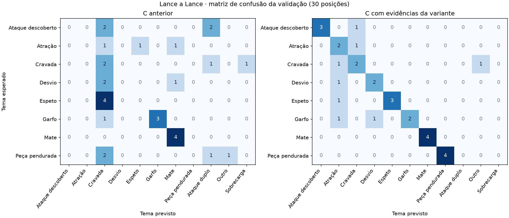

# Qualidade da versão C

## Resultados do ensaio

Na validação reservada, o acerto temático passou de **9/30 (30,00%)** para
**22/30 (73,33%)**. Houve 16 correções, três regressões, seis acertos nas duas
versões e cinco erros nas duas. A meta de 60% foi alcançada nessa amostra
interna. O acerto no desenvolvimento passou de 11/40 para 35/40. No conjunto
total, que inclui os exemplos vistos durante o ajuste, o acerto passou de
20/70 para 57/70 (81,43%).

| Métrica | Validação anterior | Validação nova | Total anterior | Total novo |
| --- | ---: | ---: | ---: | ---: |
| Explicações completas | 30/30 | 30/30 | 70/70 | 70/70 |
| Com lances ilegais | 0% | 0% | 0% | 0% |
| Melhor lance | 100% | 100% | 100% | 100% |
| Tema tático | 30,00% | 73,33% | 28,57% | 81,43% |
| Tempo médio | 11,83 s | 7,59 s | 11,71 s | 7,48 s |
| Tokens | 67.069 | 26.885 | 154.014 | 62.677 |

O tempo é o observado em cada execução e depende da carga da máquina.
A redução de tokens coincide com a remoção da chamada de escolha de tema.
As 70 explicações passaram sem fallback. Em 52, a frase sobre a alternativa
incluiu uma consequência verificada nos primeiros lances da variante. O acerto
do melhor lance mede a aderência à referência dada ao agente.
[Execução nova](results/qualidade/nova/relatorio.md) ·
[Métricas anteriores](results/qualidade/metricas_base.json) ·
[Métricas novas](results/qualidade/metricas_nova.json)

### Matriz de confusão e erros por posição



[Matriz anterior na validação](results/qualidade/matriz_base_validacao.csv) ·
[Matriz nova na validação](results/qualidade/matriz_nova_validacao.csv) ·
[Matriz anterior nas 70](results/qualidade/matriz_base_total.csv) ·
[Matriz nova nas 70](results/qualidade/matriz_nova_total.csv)

| Tema esperado na validação | Casos | Acertos anteriores | Acertos novos |
| --- | ---: | ---: | ---: |
| Ataque descoberto | 4 | 0 | 3 |
| Atração | 3 | 0 | 2 |
| Cravada | 4 | 2 | 2 |
| Desvio | 3 | 0 | 2 |
| Espeto | 4 | 0 | 3 |
| Garfo | 4 | 3 | 2 |
| Mate | 4 | 4 | 4 |
| Peça pendurada | 4 | 0 | 4 |

Nas 13 divergências do conjunto total, dez têm evidências concorrentes na
variante, duas têm o motivo esperado detectado somente na solução pública e
uma ficou sem evidência para o rótulo esperado pelas regras atuais. A primeira
jogada da punição coincidiu nas 70 posições. A sequência divergiu antes do
fim de uma das linhas em 16 casos. Isso limita a comparação de um único
rótulo com uma única linha do motor.

- Em `lichess:074ux`, `Qh1+ Ke2 Qxc1` mostra o rei saindo da linha e a torre
  atrás sendo capturada. A revisão identificou o espeto.
- Em `lichess:00ldC`, `Qe7+ Kh6 Qxf8+` sustenta o garfo esperado e também a
  saída do rei de uma casa de onde defendia a torre. A revisão preferiu
  desvio. A diferença conta como erro no cálculo de acurácia.
- Em `lichess:04GtP`, o Stockfish respondeu ao mesmo `Nf3+` com `Qxf3`,
  enquanto a solução pública respondeu `Kh1` e seguiu com `Nd4+`. O ataque
  descoberto ficou evidente no segundo ramo.

O [diagnóstico pareado](results/qualidade/diagnostico_pareado.csv) registra
os 70 casos, rótulos, variantes, evidências e IDs das fichas. Os motivos
extraídos da solução publicada pertencem à auditoria posterior à inferência.

## Protocolo congelado

A [divisão](results/qualidade/divisao.json) foi gravada antes de alterar o
grafo. O SHA-256 de `semente:id` determinou a ordem dentro de cada tema
esperado. Seis estratos com nove posições reservaram quatro para validação e
dois estratos com oito reservaram três. Ficaram 40 posições para desenvolvimento
e 30 para validação. O rótulo foi usado para estratificar e pontuar. O grafo
recebeu apenas FEN, lance da partida, melhor alternativa e variante do motor.
A divisão interna reutiliza um dataset já avaliado. Ela verifica a generalização
para exemplos reservados nesta iteração e não equivale a uma coleta externa.

A linha de base usa o checkpoint histórico completo de C, com Qwen3 1.7B local.
O arquivo da divisão guarda o hash exato do checkpoint e do dataset. A
[auditoria por posição](results/qualidade/auditoria_base.jsonl) registra os 70
casos com descrições MCP antes e depois, avaliação e variante após o erro,
a melhor alternativa, ficha e resposta. Os resultados de A e B e os rótulos
originais continuam no histórico. A ordem de temas na matriz é explícita no
CSV. Cada linha representa o tema esperado e cada coluna o tema previsto.

O perfil experimental usa Stockfish 11, profundidade 16 e MultiPV 1. O melhor
lance vem da referência congelada no dataset. A variante para identificar a
consequência é calculada após aplicar o lance real ao FEN. A revisão usa o mesmo
Qwen3 `qwen3:1.7b` Q4_K_M (`8f68893c685c`), temperatura 0, `reasoning_effort=none`,
limite de 384 tokens por chamada, 60 s por chamada e 150 s por posição. O MCP
usou o mesmo binário e um índice Chroma separado, reconstruído com os embeddings
MiniLM multilíngues e as fichas revisadas.

## Hipóteses e mudanças

A classificação anterior tinha evidência específica de garfo e mate, além de
observações genéricas sobre ataques e defesa. No desenvolvimento, os cinco
desvios viraram cravadas e nenhum dos cinco espetos foi identificado. A distinção
exige observar o que acontece em sequência. No espeto, o alvo mais valioso sai
e a peça atrás é tomada. Na cravada, o alvo dianteiro fica limitado pela peça
atrás. No desvio, importa a defesa que a peça abandona. Na atração, importa a
ameaça à própria peça na casa para onde ela é levada.

O módulo `agent/taticas.py` reproduz até dez meios-lances legais e inspeciona
os primeiros quatro lances do lado que pune o erro. Ele procura oito motivos.
As regras exigem geometria, captura, deslocamento do defensor ou anúncio de
mate conforme o tema. A ordem é determinada pela força da evidência, com uma
redução de três pontos por meio-lance transcorrido para penalizar motivos
tardios. Empates usam o índice do lance e o identificador. O grafo registra
as evidências concorrentes. Se a variante ficar sem um motivo sustentado,
usa `outro` e conserva apenas observações do tabuleiro. Mate anunciado recebe
prioridade máxima quando imediato. Um motivo específico pode ser mais
informativo que um mate posterior na mesma linha.

O LangGraph usa a descrição MCP para a primeira frase, a evidência da variante
para a segunda e a lição escolhida pelo LLM na ficha para a terceira. A quarta
frase traz a alternativa validada pelo Stockfish, com uma justificativa local
quando os primeiros lances da variante sustentam uma. Toda jogada publicada
continua passando pelo validador. O LLM seleciona a lição entre frases
verificáveis da ficha. Ele deixa de escolher o rótulo por preferência textual.

A [auditoria das fichas](results/qualidade/auditoria_fichas.json) verificou
30 identificadores, metadados e seis seções por ficha. A busca real pelo título
colocou o documento correto em primeiro lugar em 21/30 consultas livres e 30/30
com filtro. Nas 70 saídas anteriores, a ficha tinha o mesmo ID do tema previsto.
Um rótulo errado portanto encaminhava a recuperação para um conceito inadequado
mesmo quando o filtro funcionava. Foram ajustadas as instruções de garfo,
espeto, desvio e atração para distinguir os mecanismos e evitar tratar o
garfo como exclusivo do cavalo. Os exemplos e os metadados foram preservados.

## Fidelidade

Foram selecionadas oito posições da validação, uma de cada tema esperado,
antes do ajuste. As mesmas posições são avaliadas nas duas versões em dois
regimes pareados. `ficha` oferece somente o trecho conceitual real recuperado.
`ficha_e_tabuleiro` também inclui a descrição de ataques, as jogadas e os fatos
extraídos das variantes do Stockfish, num contexto fixo produzido antes da
mudança de código. Os vereditos e as afirmações de cada posição são exportados.
A métrica mede a proporção de afirmações sustentadas pelo contexto fornecido.
[Documentação do RAGAS Faithfulness](https://docs.ragas.io/en/stable/concepts/metrics/available_metrics/faithfulness/)

| Regime nas mesmas oito posições | C anterior | C nova |
| --- | ---: | ---: |
| Trecho da ficha | 0,15625 | 0,28125 |
| Trecho da ficha e fatos do tabuleiro | 0,62500 | 0,50000 |

A meta de 0,80 não foi alcançada. A melhora com a ficha isolada coexiste
com queda no regime ampliado. A média histórica de 0,25 em três exemplos
pertence a outra amostra. [Notas pareadas](results/qualidade/ragas_pareado.csv) ·
[Respostas, contextos e vereditos anteriores](results/qualidade/ragas_base.jsonl) ·
[Respostas, contextos e vereditos novos](results/qualidade/ragas_nova.jsonl)

O juiz foi Qwen3 1.7B local, RAGAS 0.4.3, temperatura 0,
`reasoning_effort=none` e timeout de 210 s. A decomposição da resposta é
compartilhada entre os dois regimes naquela posição. A própria família de
modelo que redige foi usada como juiz. Uma ficha sobre um motivo não contém
o FEN específico, a melhor alternativa ou a captura que ocorreu. Falta de
suporte no trecho conceitual, erro de xadrez e erro de julgamento são hipóteses
diferentes. Uma declaração genérica sobre a variante também pode ser aceita
pelo juiz sem identificar o alvo com precisão. A revisão por pessoas e uma
amostra externa permanecem pendentes.

Em `lichess:06uwS`, o contexto fixo diz expressamente que as pretas jogaram
`Bd1` com o bispo e que o cavalo branco jogou `Ne3+` e depois capturou o bispo
em `d1`. O juiz marcou como sem suporte as duas afirmações correspondentes
mesmo com o contexto ampliado. Há também desacertos de seleção na linha de
base. Em `lichess:08un8`, por exemplo, o texto entrega uma lição de sobrecarga
porque esse foi o tema previsto, embora o rótulo primário seja cravada.

## Reprodução

Com o modelo local e o MCP real de referência em execução, os artefatos de
linha de base podem ser recriados em uma pasta vazia. Use o perfil documentado
em [avaliação](README.md). Para reproduzir exatamente a busca das fichas da
auditoria inicial, use um MCP que indexou as fichas históricas. É possível
restaurar esse estado em uma cópia do projeto revertendo o
[patch da revisão](results/qualidade/revisao-agente.patch). Os hashes do
código e das fichas restaurados conferem com o manifesto histórico.
[Proveniência da linha de base](results/qualidade/proveniencia_base.json)

```bash
python -m evaluation.qualidade preparar /tmp/lance-qualidade
python -m evaluation.qualidade comparar /tmp/lance-qualidade
RAGAS_DO_NOT_TRACK=true python -m evaluation.qualidade julgar /tmp/lance-qualidade --nome base
python -m evaluation.run_eval --versoes C --completa --timeout 150 --resultados /tmp/lance-qualidade-nova
python -m evaluation.qualidade comparar /tmp/lance-qualidade --checkpoint /tmp/lance-qualidade-nova/checkpoint.jsonl
python -m evaluation.qualidade diagnosticar /tmp/lance-qualidade --checkpoint /tmp/lance-qualidade-nova/checkpoint.jsonl
RAGAS_DO_NOT_TRACK=true python -m evaluation.qualidade julgar /tmp/lance-qualidade --nome nova --checkpoint /tmp/lance-qualidade-nova/checkpoint.jsonl
```

A preparação e os relatórios usam criação exclusiva de arquivos. O juiz pode
retomar sua execução sem repetir pares já registrados por posição e regime.

## Testes e pendências

A regressão final aprovou 130 testes, sem falhas ou testes ignorados, com
Stockfish e embeddings reais habilitados. As fixtures de LLM verificam o
contrato e a rejeição de lances inválidos. A geração real foi verificada
fora dessas fixtures. Em HTTP, `lichess:074ux` retornou o espeto com quatro
frases, a segunda chamada reutilizou o cache e `Qz9` recebeu HTTP 422.
[Registro HTTP](results/qualidade/http.json)

A próxima verificação de pesquisa pode comparar mais de uma variante do
adversário, avaliar concordância humana em casos multitema e usar um juiz
autorizado independente com evidências do tabuleiro mais explícitas. O
conjunto oficial segue com 70/100 posições, e as notas humanas e as 30
posições rotuladas de partidas dos participantes continuam pendentes.
