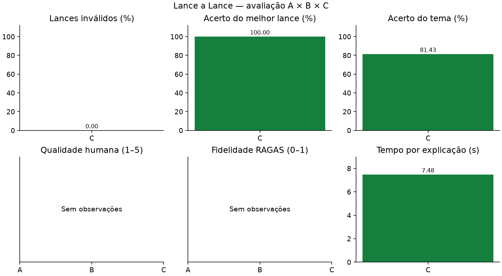

# Avaliação Lance a Lance

**Avaliação incompleta**.
Dataset com 70/100 posições, 70 da Lichess e 0 de partidas do grupo. 0 tríades completas.
Modelo configurado: qwen3:1.7b. Semente da amostra cega: 20261119.

## Disponibilidade

- C: Disponível.

## Leitura dos dados

- A: 0/70 posições tentadas, 0 completas, 0 incompletas, 0 falhas e 0 fallbacks com texto.
- B: 0/70 posições tentadas, 0 completas, 0 incompletas, 0 falhas e 0 fallbacks com texto.
- C: 70/70 posições tentadas, 70 completas, 0 incompletas, 0 falhas e 0 fallbacks com texto.

As comparações abaixo usam apenas posições com respostas completas nas três versões.

1. Menor taxa de lances inválidos: Dados pareados insuficientes.
2. Efeito do Stockfish no prompt: dados pareados insuficientes.
3. RAG: 0 escores de fidelidade. A e B são inaplicáveis. O desenho A/B/C combina RAG, ferramentas e validação em C.
4. Validador: 0 rascunhos com lances inválidos em 70 rascunhos inspecionados. Taxa final de C: 0.00% em 70 explicações.
5. Maior custo estimado: Cobertura de preços e tokens insuficiente nas tríades.
6. Maior tempo médio: Dados pareados insuficientes.
7. Limitações: ratings de puzzle e de jogador têm origens distintas, os rótulos públicos são multitema e a extração cobre citações em notação de xadrez. A alternativa de C é inserida pelo grafo a partir do motor. O estudo compara sistemas completos e não isola o efeito causal do RAG.
8. Metas documentais de C:

- invalidos_pct: pendente. Valor observado: 0.0. Meta: 0.0.
- melhor_pct: pendente. Valor observado: 100.0. Meta: 95.0.
- tema_pct: pendente. Valor observado: 81.42857142857143. Meta: 60.0.
- humana_media: pendente. Valor observado: n/d. Meta: 4.0.
- ragas_media: pendente. Valor observado: n/d. Meta: 0.8.

## Exemplos lado a lado

Nenhuma tríade de respostas disponível.
