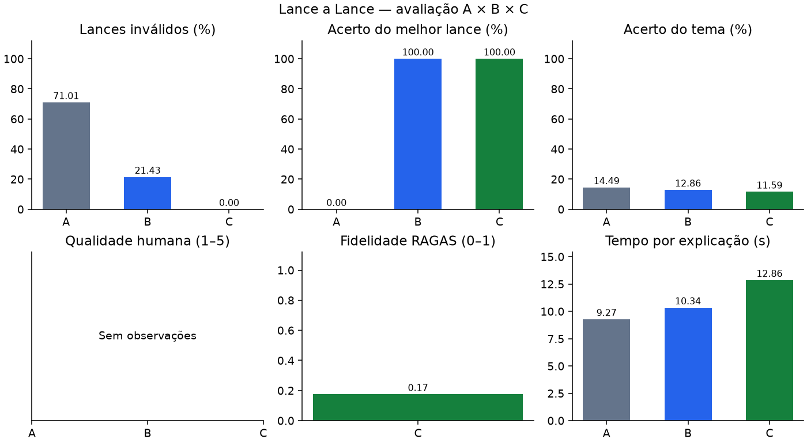

# Avaliação Lance a Lance

**Avaliação incompleta**.
Dataset com 70/100 posições, 70 da Lichess e 0 de partidas do grupo. 68 tríades completas.
Modelo configurado: qwen3:1.7b. Semente da amostra cega: 20261119.

## Disponibilidade

- A: Disponível.
- B: Disponível.
- C: Disponível.

## Leitura dos dados

- A: 70/70 posições tentadas, 69 completas, 1 incompletas, 0 falhas e 0 fallbacks com texto.
- B: 70/70 posições tentadas, 70 completas, 0 incompletas, 0 falhas e 0 fallbacks com texto.
- C: 70/70 posições tentadas, 69 completas, 1 incompletas, 0 falhas e 1 fallbacks com texto.

As comparações abaixo usam apenas posições com respostas completas nas três versões.

1. Menor taxa de lances inválidos: C (0.000).
2. B versus A com Stockfish: -51.47 pp em lances inválidos, +100.00 pp em melhor lance e -1.47 pp em tema, em 68 posições.
3. RAG: 10 escores de fidelidade (média 0.175). A e B são inaplicáveis. O desenho A/B/C combina RAG, ferramentas e validação em C.
4. Validador: 0 rascunhos com lances inválidos em 79 rascunhos inspecionados. Taxa final de C: 0.00% em 69 explicações.
5. Maior custo estimado: Cobertura de preços e tokens insuficiente nas tríades.
6. Maior tempo médio: C (12.868).
7. Limitações: ratings de puzzle e de jogador têm origens distintas, os rótulos públicos são multitema e a extração cobre citações em notação de xadrez. A alternativa de C é inserida pelo grafo a partir do motor. O estudo compara sistemas completos e não isola o efeito causal do RAG.
8. Metas documentais de C:

- invalidos_pct: pendente. Valor observado: 0.0. Meta: 0.0.
- melhor_pct: pendente. Valor observado: 100.0. Meta: 95.0.
- tema_pct: pendente. Valor observado: 11.594202898550725. Meta: 60.0.
- humana_media: pendente. Valor observado: n/d. Meta: 4.0.
- ragas_media: pendente. Valor observado: 0.175. Meta: 0.8.

## Exemplos lado a lado

### lichess:0068B

**A**

> O lance Nd7 é uma jogada de garfo que tenta controlar a dama e pressionar o peão da dama. O jogador está tentando estabelecer uma posição de vantagem com o garfo, mas a posição atual não é ideal para o nível de jogador até 1800. O lance pode ser fraco devido à falta de coordenação e pressão efetiva.

**B**

> O lance Nd7 é uma jogada de garfo, buscando controlar a dama e pressionar o peão em b5. O melhor lance é b5, que é uma jogada de ataque descoberto, controlando a dama e pressionando o peão em b5. A linha de jogadas inclui opções de sobrecarga e desvio, que podem ser úteis para controlar o centro do tabuleiro.

**C**

> O lance da partida deslocou um cavalo das pretas. Na posição resultante, a peça movida está sob ataque e tem defesa. Evite movimentar peças que estejam sob ataque, especialmente se houver defesa disponível, pois isso pode prejudicar a posição geral do jogador. O Stockfish indicou `b5` como alternativa.

### lichess:007OE

**A**

> O lance axb3 é uma variante de posição onde o jogador está em posição de ataque, mas a posição atual não é ideal para uma jogada de qualidade. Oponente tem uma posição de vantagem, e o lance não está alinhado com a estratégia de controle e pressão que o jogador busca. O lance é uma tentativa, mas não é a melhor opção.

**B**

> O lance axb3 é uma variante de posição de jogo onde o jogador está em posição de ataque. O valor de avaliação é moderado, indicando que o jogo ainda não está no melhor momento. O melhor lance é Qxb3+ porque ele oferece uma ameaça de mate e controla a posição central, que é crucial para o jogo. A variante começa com o FEN fornecido e segue como uma sequência contínua em SAN, evitando coordenadas isoladas.

**C**

> O lance da partida deslocou um peao das brancas. Na posição resultante, o lado a jogar dispõe de pelo menos um xeque legal. Evite deslocar peões que deixem o jogador em posição de xeque, especialmente se houver uma alternativa de xeque legal. O Stockfish indicou `Qxb3+` como alternativa.

### lichess:00C8e

**A**

> O lance Qa4+ é uma jogada de ataque descoberto, onde a rainha branca ataca a posição da rainha negra em a4, tentando desviar a atenção do jogador negro. A posição é complicada, e a rainha branca está em posição de contra-ataque. O lance é válido e pode ser uma alternativa interessante, mas não é a melhor opção no momento.

**B**

> O jogador jogou a posição Qa4+ como uma alternativa, tentando pressionar o rei e criar pressão no centro. A avaliação do lance é positiva, mas a melhor jogada é Qd5+ que oferece maior pressão e controle do centro. O tema é 'ataque_descoberto', pois o lance busca explorar a posição do rei e criar uma vantagem de pressão.

**C**

> O lance da partida deslocou uma dama das pretas. Compare as ameaças da posição resultante com a alternativa analisada. Evite que a dama das pretas ataque dois alvos simultaneamente, pois uma das ameaças pode ser prejudicial ou não ser capturada. O Stockfish indicou `Qd5+` como alternativa.

