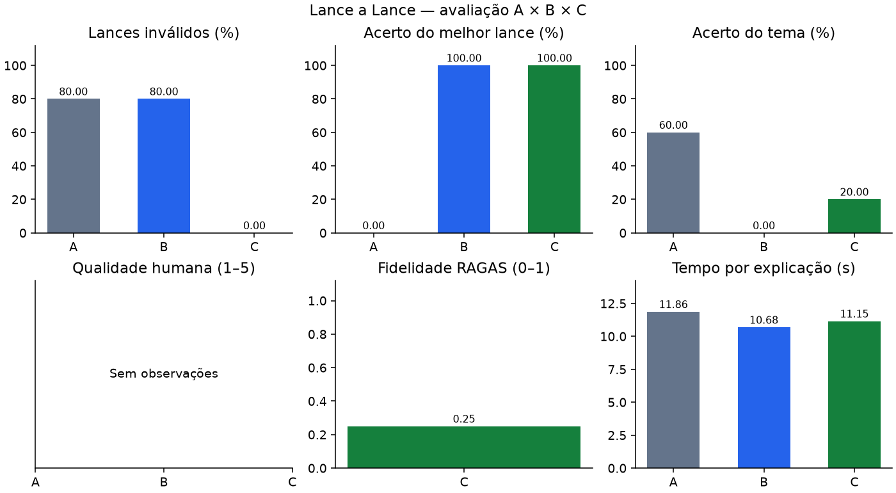

# Avaliação Lance a Lance

**Avaliação incompleta**.
Dataset com 5/100 posições, 5 da Lichess e 0 de partidas do grupo. 5 tríades completas.
Modelo configurado: qwen3:1.7b. Semente da amostra cega: 20261119.

## Disponibilidade

- A: Disponível.
- B: Disponível.
- C: Disponível.

## Leitura dos dados

- A: 5/5 posições tentadas, 5 completas, 0 incompletas, 0 falhas e 0 fallbacks com texto.
- B: 5/5 posições tentadas, 5 completas, 0 incompletas, 0 falhas e 0 fallbacks com texto.
- C: 5/5 posições tentadas, 5 completas, 0 incompletas, 0 falhas e 0 fallbacks com texto.

As comparações abaixo usam apenas posições com respostas completas nas três versões.

1. Menor taxa de lances inválidos: C (0.000).
2. B versus A com Stockfish: +0.00 pp em lances inválidos, +100.00 pp em melhor lance e -60.00 pp em tema, em 5 posições.
3. RAG: 3 escores de fidelidade (média 0.250). A e B são inaplicáveis. O desenho A/B/C combina RAG, ferramentas e validação em C.
4. Validador: 0 rascunhos com lances inválidos em 5 rascunhos inspecionados. Taxa final de C: 0.00% em 5 explicações.
5. Maior custo estimado: Cobertura de preços e tokens insuficiente nas tríades.
6. Maior tempo médio: A (11.863).
7. Limitações: ratings de puzzle e de jogador têm origens distintas, os rótulos públicos são multitema e a extração cobre citações em notação de xadrez. A alternativa de C é inserida pelo grafo a partir do motor. O estudo compara sistemas completos e não isola o efeito causal do RAG.
8. Metas documentais de C:

- invalidos_pct: pendente. Valor observado: 0.0. Meta: 0.0.
- melhor_pct: pendente. Valor observado: 100.0. Meta: 95.0.
- tema_pct: pendente. Valor observado: 20.0. Meta: 60.0.
- humana_media: pendente. Valor observado: n/d. Meta: 4.0.
- ragas_media: pendente. Valor observado: 0.25. Meta: 0.8.

## Exemplos lado a lado

### lichess:03726

**A**

> O lance Rc8 (cavalo para a 8ª casa) é uma variante de posição de jogo que pode ser vantajosa, mas não é a melhor opção no momento. O jogador está em posição de ataque, mas precisa cuidar da posição da peça e da segurança das peças principais. O cavalo está em posição de ataque, mas pode ser capturado ou colocar o oponente em posição de contra-ataque.

**B**

> O jogador jogou Rc8, que é uma jogada de posição, mas não é a melhor. A melhor jogada seria Rxf4, que ataca a dama e controla o centro. O lance Qd5 é também bom, mas não é tão eficaz quanto Rxf4. O lance Bxe5 e Re6 são mais de longe menos eficazes. A avaliação do motor é positiva, mas a melhor jogada é Rxf4.

**C**

> O lance da partida deslocou uma torre das pretas. Na variante analisada, a mesma peça dá xeque e também ataca uma torre. Procurar xeques e ataques simultâneos do adversário antes de jogar é uma estratégia eficaz para evitar perdas e manter a posição em equilíbrio. O Stockfish indicou `Rxf4` como alternativa.

### lichess:04GtP

**A**

> O lance Ne3 (não-e3) é uma variante de posição onde o jogador tenta atacar a dama do oponente com o peão em e3. A posição atual é vantajosa para o jogador, pois permite uma ataque duplo com o peão em e3 e o peão em d4. O lance é válido e segue o padrão SAN, evitando coordenadas isoladas.

**B**

> O lance Ne3 (não-e3) é uma variante de posição de jogo que pode ser útil para controlar a posição da peça e criar pressão no centro. O melhor lance, f4, é uma jogada de qualidade que controla o centro e prepara para uma posição de vantagem. A avaliação de 702 pontos indica que o jogador está em posição de vantagem, mas ainda precisa de cuidado para evitar erros de posição.

**C**

> O lance da partida deslocou um cavalo das brancas. Na posição resultante, o lado a jogar dispõe de pelo menos um xeque legal. Evite mover o rei ou a dama sem verificar se há casas de salto do cavalo inimigo disponíveis, pois isso pode criar uma situação de xeque legal para o lado a jogar. O Stockfish indicou `f4` como alternativa.

### lichess:06uwS

**A**

> O lance Bd1 é uma variante de posição onde o jogador está em uma posição de vantagem, mas a jogada pode não ser a mais adequada. O movimento de dama para a posição b1 pode ser uma escolha, mas pode não ser a melhor opção devido à posição da dama e das peças. O jogador precisa avaliar a posição com cuidado, especialmente com a presença de peças que podem oferecer vantagem ou colocar o oponente em posição de contra-ataque.

**B**

> O lance Bd1 é uma variante de posição de pé, onde o jogador está em posição de defesa. O melhor lance é Bh5, que ataca o peão da casa d8 e pressiona o oponente. O motor de avaliação está avaliando a posição com uma avaliação de 0, o que indica que a posição é equilibrada, mas ainda não está em vantagem. A lição é que, mesmo em posições de defesa, é possível encontrar jogadas que criem pressão e oportunidades de vantagem.

**C**

> O lance da partida deslocou um bispo das pretas. Na variante analisada, a mesma peça dá xeque e também ataca um bispo. Procurar xeques e ataques simultâneos do adversário antes de jogar é uma boa estratégia para evitar perdas e manter a posição em equilíbrio. O Stockfish indicou `Bh5` como alternativa.

